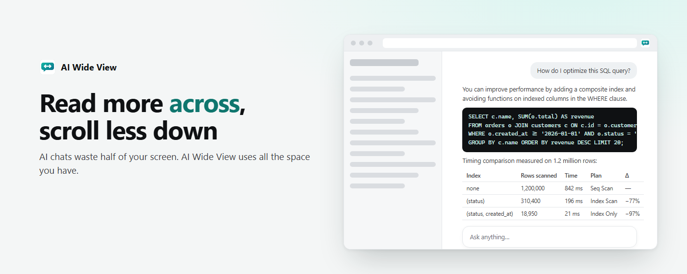
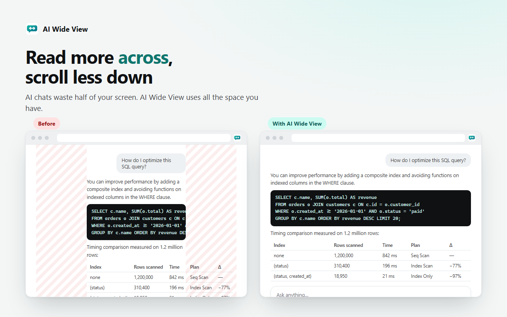
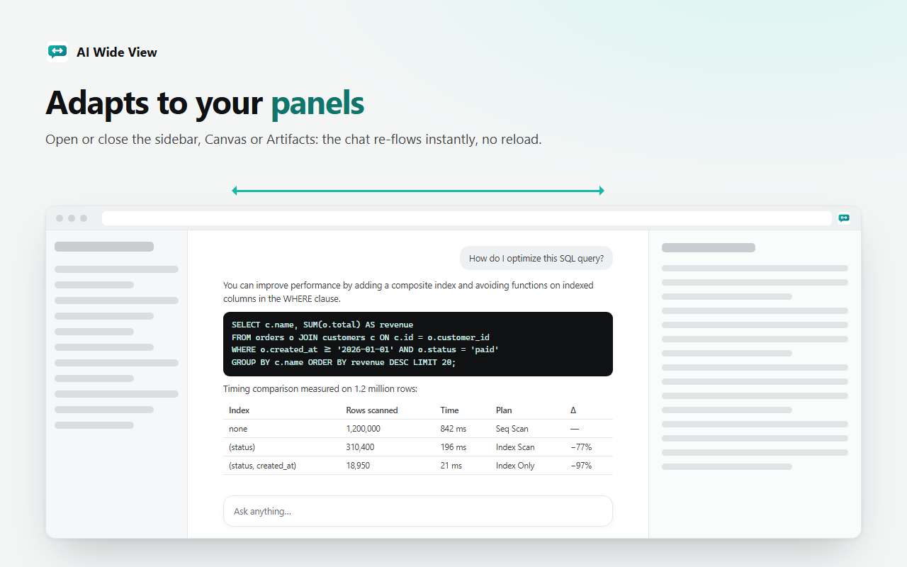
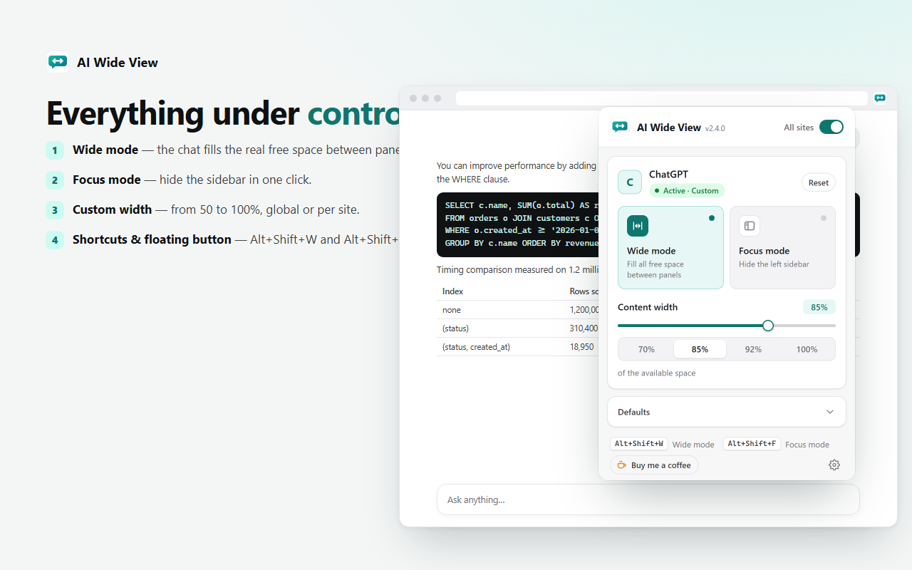
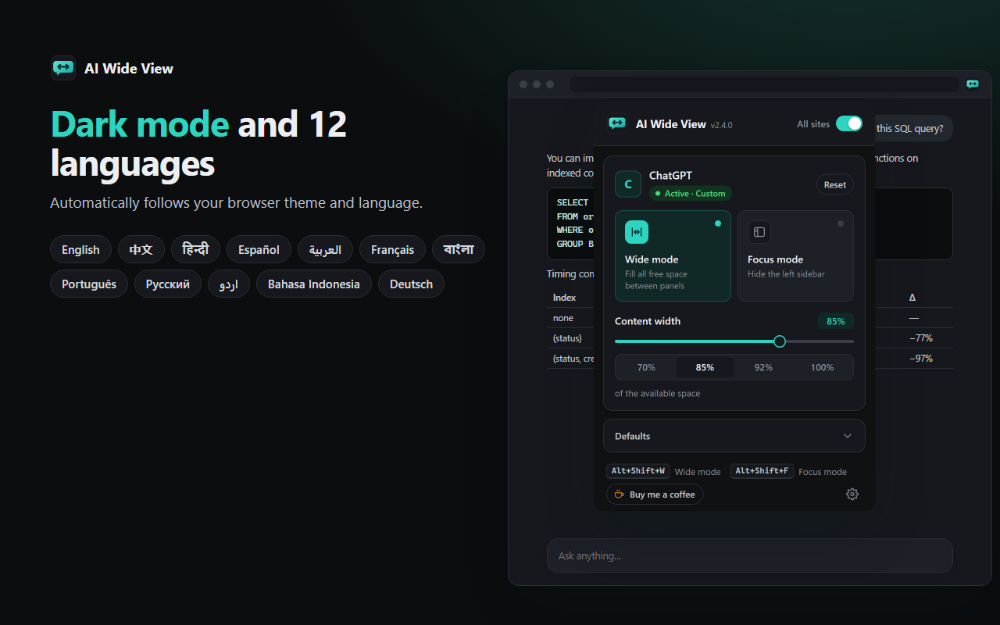
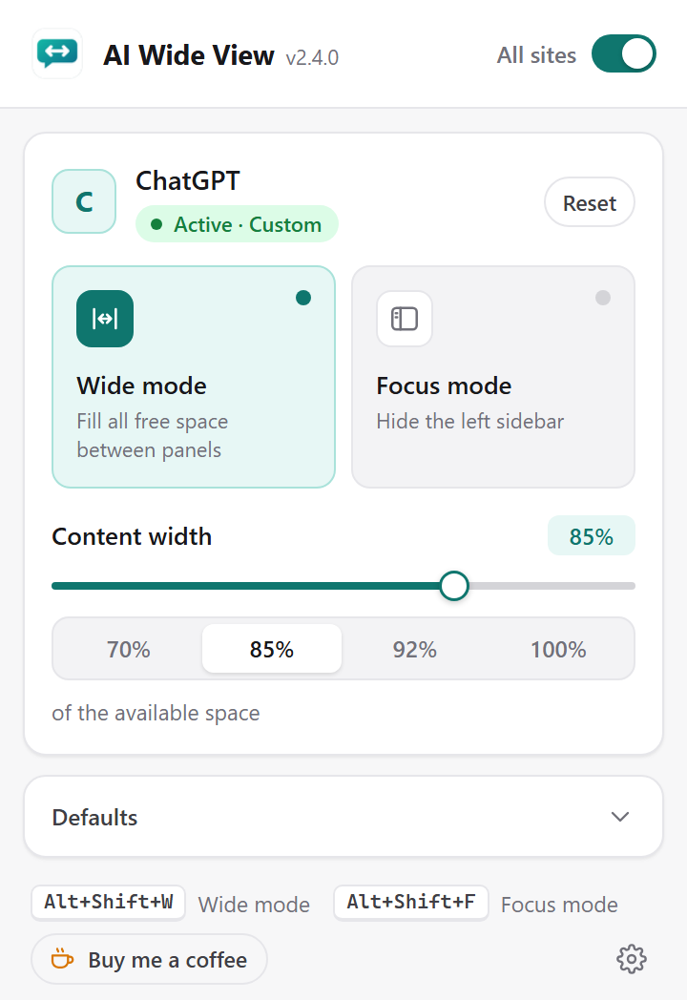
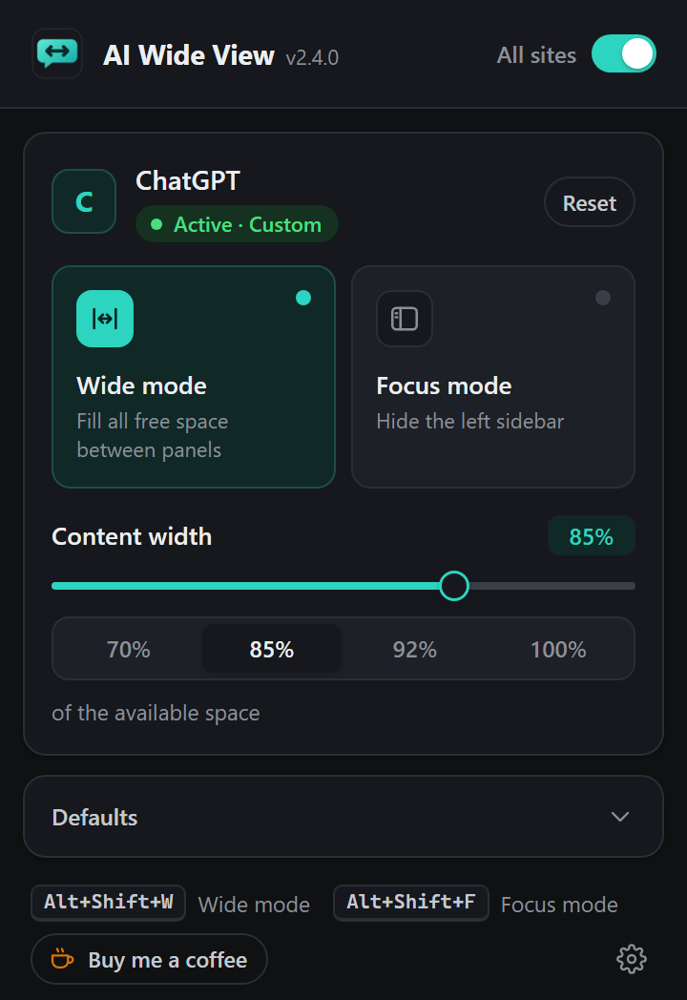

<p align="center">
  <picture>
    <source media="(prefers-color-scheme: dark)" srcset="docs/images/icon-dark.png">
    
  </picture>
</p>

<h1 align="center">AI Wide View</h1>

<p align="center">
  <strong>Read more across, scroll less down.</strong><br>
  A Chrome extension that makes AI chats use the full width of your screen — and re-adapts when side panels open or close.
</p>

<p align="center">
  <!-- Replace EXTENSION_ID once the item is published on the Chrome Web Store -->
  <a href="https://chromewebstore.google.com/detail/EXTENSION_ID"></a>
  
  
  
  <a href="https://buymeacoffee.com/veslava.ia"></a>
</p>

<p align="center">
  
</p>

---

## Why

Web interfaces of AI chats are narrow by design: answers live in a ~760 px column while the sides of a desktop monitor stay empty. Long answers, code and tables end up wrapped and endlessly scrolled. **AI Wide View** removes that limit so the conversation fills the space you actually have.

## Features

- **Wide mode** — text, code and tables fill the real free space between panels, from 50 to 100% of it (live preview and quick presets).
- **Adapts to your panels** — open or close the sidebar, Canvas, Artifacts or any side panel and the chat re-flows instantly, with no reload. Width is computed from the free space, never from the window size, so nothing overflows.
- **Focus mode** — hide the left sidebar in one click and reclaim the gap it leaves.
- **Global or per-site settings** — plus a master switch to turn everything on or off at once.
- **Keyboard shortcuts** — `Alt+Shift+W` (wide mode) and `Alt+Shift+F` (focus mode), customizable in `chrome://extensions/shortcuts`.
- **Floating button** — a discreet, draggable control on the edge of the page.
- **Any site on demand** — not in the list? Click **“Enable on this site”** and the extension asks for permission for that single domain.
- **Light & dark mode** — popup, floating button and toolbar icon follow your system theme.
- **12 languages** — English, Chinese, Hindi, Spanish, Arabic (RTL), French, Bengali, Portuguese, Russian, Urdu (RTL), Indonesian and German, picked from your browser preferences or chosen manually.
- **Private by design** — no data collection, no network requests, no analytics, no remote code.

## Screenshots

<table>
  <tr>
    <td width="50%"></td>
    <td width="50%"></td>
  </tr>
  <tr>
    <td></td>
    <td></td>
  </tr>
</table>

<p align="center">
  
  &nbsp;&nbsp;
  
</p>

## Supported AI chats

| Western | Chinese |
|---|---|
| ChatGPT · Claude · Gemini · Google AI Studio · NotebookLM · Microsoft Copilot · Perplexity · Grok · Mistral Le Chat · Meta AI · Poe · HuggingChat · LMArena · OpenRouter · Manus · Duck.ai · Lumo · Venice · You.com · Pi · Character.AI · PolyBuzz · Lovable | DeepSeek · Kimi · Qwen Chat · Tongyi Qianwen · Doubao · Z.ai (GLM) · ChatGLM · Tencent Yuanbao · MiniMax · ERNIE Bot · StepFun · Tiangong |

…and **any other site** you enable from the popup.

## Installation

### From the Chrome Web Store

[Install AI Wide View](https://chromewebstore.google.com/detail/EXTENSION_ID) — works in Chrome, Edge, Brave and other Chromium browsers (version 111+).

### From source

1. Download or clone this repository.
2. Open `chrome://extensions` and turn on **Developer mode**.
3. Click **Load unpacked** and select the project folder.

Tabs that were already open are activated automatically — no reload needed.

## Usage

1. Open any supported AI chat: wide mode is on by default.
2. Click the toolbar icon to adjust the width, toggle focus mode, reset a site to the global settings or change the defaults (default width, floating button, language).
3. Use `Alt+Shift+W` / `Alt+Shift+F` or the floating button to toggle modes without opening the popup.

## How it works

Chat apps narrow their content with centered containers that have a pixel `max-width` (e.g. 768 px). Instead of relying on brittle per-site class names, the content script:

1. Starts from *anchor* nodes (messages and the composer) and walks up the DOM.
2. Marks every centered element whose pixel `max-width` is actually limiting it.
3. Replaces that limit, via CSS, with a **percentage of its parent**.

Because the parent is the space left between panels, opening or closing a sidebar re-flows the layout **with pure CSS**. Nested limits are found in successive passes. Scans are throttled, run in `requestIdleCallback` and separate reads from writes to avoid layout thrashing. Per-site hints in [`lib/sites.js`](lib/sites.js) help the engine but are not required.

## Project structure

```text
manifest.json        Manifest V3: permissions, shortcuts, content scripts
background.js        Service worker: injection into open tabs, shortcuts, custom sites, themed icon
content.js           Engine: wide mode, focus mode, floating button
lib/sites.js         Site registry (shared)
lib/settings.js      Global / per-site settings model (shared)
lib/i18n.js          Language detection and string loading (shared)
i18n/<lang>.json     UI strings (12 languages)
_locales/            Name, description and shortcut labels shown by Chrome
popup.html/js        Extension popup
styles.css           Popup styles (light & dark)
icons/               Toolbar icons (light) and icons/dark/ (dark)
scripts/package.py   Builds dist/ai-wide-view-<version>.zip for the Chrome Web Store
docs/                Images for this README and technical notes
```

## Development

```bash
# Build the Chrome Web Store package (validates the manifest, descriptions and JS syntax)
python scripts/package.py

# Regenerate the standalone popup preview (design/popup-preview.html)
python scripts/build_preview.py
```

**Adding a site:** add an entry to `lib/sites.js` (`hosts`, and optionally `anchors`, `sidebar`, `css`) and add the domain to both `host_permissions` and `content_scripts.matches` in `manifest.json`. The generic engine usually works without extra hints. In an unpacked install the popup shows a **Diagnostics** panel (widened containers, detected sidebar) to help tune a site.

**Adding a language:** create `i18n/<code>.json` and add the code to `LANGS` in `lib/i18n.js`.

Technical notes in Spanish: [`docs/DEVELOPMENT.es.md`](docs/DEVELOPMENT.es.md).

## Privacy

AI Wide View collects and sends **no data**. Preferences are stored with `chrome.storage` in your browser. Read the full [privacy policy](PRIVACY.md).

## Support the project

AI Wide View is free and ad-free. If it saves you time, you can [buy me a coffee ☕](https://buymeacoffee.com/veslava.ia). Bug reports and site requests are welcome in [Issues](https://github.com/eslava-ai/aiwideview/issues).

## Disclaimer

AI Wide View is an independent project and is not affiliated with, sponsored or endorsed by OpenAI, Anthropic, Google, Microsoft, xAI, DeepSeek, Alibaba, Moonshot AI, ByteDance, Tencent or any other service mentioned. All trademarks belong to their respective owners.

